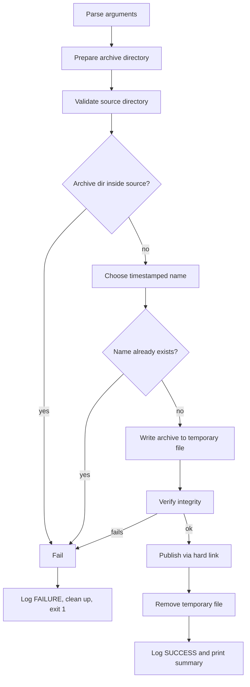
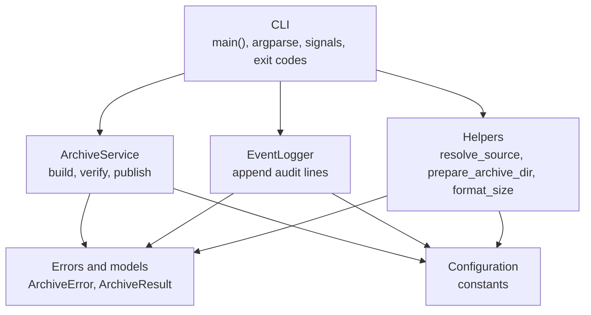

# Log Archive Tool

A command-line tool, written in **Bash** with a **Python** implementation, that compresses a log directory into a timestamped `tar.gz` archive, verifies it, and records every run in an event log. Original files are never modified or deleted.

```
 ./log-archive.sh /var/log
Source:      /var/log
Destination: /home/user/log-archives/logs_archive_20240816_100648.tar.gz
Creating compressed archive...
Verifying archive integrity...

Archive created and verified successfully.
Archive: /home/user/log-archives/logs_archive_20240816_100648.tar.gz
Size:    12M
Log:     /home/user/log-archives/archive.log
```

## Overview

Logs pile up. Keeping them uncompressed wastes disk space, but deleting them loses history. This tool takes a log directory (typically `/var/log`), compresses its contents into a single timestamped archive in a separate directory, and logs when each archive was made. Run by hand or on a schedule, it gives you compact, dated snapshots of your logs.

The project meets the following requirements:

- Runs from the command line and takes the log directory as an argument
- Compresses the logs into a `tar.gz` file and stores it in a new directory
- Logs the date and time of each archive to a file
- Names archives with the date and time, i.e `logs_archive_20240816_100648.tar.gz`

The primary deliverable is the Bash script, `log-archive.sh`. `log-archive.py` is a Python implementation with the same behaviour, written as a second take on the same problem.

## Features

- Archives everything in the directory, including hidden files and subdirectories
- Timestamped archive names that are never overwritten
- Integrity check (gzip and tar) before an archive is published
- Atomic publishing: a partial archive never appears under its final name
- Append-only event log of successes and failures
- Owner-only permissions on archives (`umask 077`)
- Refuses to write the archive inside the directory being archived
- Cleans up temporary files on failure, Ctrl+C and `SIGTERM`
- Two implementations with the same interface, output and exit codes

## Repository structure

```
.
├── log-archive.sh    # Bash implementation (primary)
├── log-archive.py    # Python implementation (equivalent)
└── README.md
```

## Requirements

| Implementation | Needs                                                                 |
| -------------- | --------------------------------------------------------------------- |
| Bash           | Bash, and `tar`, `gzip`, `awk`, `date`, `mkdir`, `mktemp`, `ln`, `rm`, `touch`, `du` (the script checks for these at startup) |
| Python         | Python 3.9+, standard library only                                    |

Both target Linux and other Unix-like systems.

## Installation

```bash
git clone <repository-url>
cd <repository-name>
chmod +x log-archive.sh log-archive.py
```

Optionally, put one of them on your `PATH` as `log-archive`:

```bash
sudo ln -s "$(pwd)/log-archive.sh" /usr/local/bin/log-archive
```

## Usage

```
log-archive <log-directory>
```

| Argument          | Description                               |
| ----------------- | ----------------------------------------- |
| `<log-directory>` | Directory whose contents will be archived |

Bash:

```bash
./log-archive.sh /var/log
```

Python:

```bash
./log-archive.py /var/log
```

Reading `/var/log` usually requires elevated privileges:

```bash
sudo ./log-archive.sh /var/log
```

When run with `sudo`, `$HOME` may resolve to root's home directory, so archives land in `/root/log-archives`.

## Output

| Item      | Location                                             |
| --------- | ---------------------------------------------------- |
| Archives  | `$HOME/log-archives/logs_archive_YYYYMMDD_HHMMSS.tar.gz` |
| Event log | `$HOME/log-archives/archive.log`                     |

Each run adds one line to the event log, in the form `timestamp | STATUS | message`:

```
2024-08-16 10:06:48 | SUCCESS | Source=/var/log | Archive=/home/user/log-archives/logs_archive_20240816_100648.tar.gz | Size=12M
2024-08-16 10:07:15 | FAILURE | Source is not an existing directory: /nope
```

Paths inside an archive are relative to the source directory, so extracting never writes over the original location:

```bash
tar -tzf ~/log-archives/logs_archive_20240816_100648.tar.gz            # list contents
mkdir -p /tmp/restore
tar -xzf ~/log-archives/logs_archive_20240816_100648.tar.gz -C /tmp/restore
```

## Scheduling

Each invocation creates one archive, so scheduling is left to the system. A cron entry that archives `/var/log` every day at 02:00 (edit with `sudo crontab -e`):

```cron
0 2 * * * /usr/local/bin/log-archive /var/log
```

The event log gives you a record of every scheduled run, including failures.

## Architecture

### Shared design

Both implementations follow the same pipeline, so they behave the same way from the outside.



Key ideas:

1. **Build in a temporary file.** The archive is written to a hidden temp file inside the destination directory, so it is on the same filesystem as the final path.
2. **Verify before publishing.** The archive is read back and checked before it gets its real name.
3. **Publish atomically.** A hard link gives the temp file its final name. Unlike a plain move, `ln` refuses to replace an existing file.
4. **Log every outcome.** Success and failure both append a line to `archive.log`.

### Bash implementation

`log-archive.sh` is organised as small single-purpose functions. `main` calls them in order.

| Function            | Responsibility                                                              |
| ------------------- | --------------------------------------------------------------------------- |
| `usage`             | Prints help text                                                            |
| `validate_input`    | Checks argument count, that the source is a readable, searchable directory  |
| `check_dependencies`| Confirms every required utility is installed                                |
| `setup_archive_dir` | Creates and resolves `$HOME/log-archives`, sets the event log path          |
| `log_event`         | Appends a `timestamp \| STATUS \| message` line to the event log            |
| `fail`              | Prints an error, logs `FAILURE`, exits 1                                    |
| `cleanup`           | `EXIT` trap: removes the temporary archive                                  |
| `handle_signal`     | `INT` and `TERM` traps: logs the interruption                               |
| `create_archive`    | The main workflow: name, temp file, `tar -czf`, verify, `ln`, log           |
| `main`              | Wires the above together and installs traps                                 |

The script runs under `set -euo pipefail` and `umask 077`. The archive is created with `tar -czf ... -C "$source_dir" .`, which stores relative paths and includes dotfiles. It is verified with `gzip -t` and `tar -tzf`.

### Python implementation

`log-archive.py` is a single file organised into layers, each depending only on the ones above it.



| Layer             | Responsibility                                                                   |
| ----------------- | -------------------------------------------------------------------------------- |
| Configuration     | Names, formats and exit codes as constants                                       |
| Errors and models | `ArchiveError` hierarchy and the `ArchiveResult` value object                    |
| Helpers           | Pure functions: validate the source, prepare the destination, format sizes       |
| `EventLogger`     | Writes the event log lines                                                       |
| `ArchiveService`  | The workflow. It raises exceptions and never prints errors or exits              |
| CLI               | Parses arguments, handles signals, turns exceptions into messages and exit codes |

The Python version uses `tarfile` and `os.link` instead of external utilities, a `finally` block for temp-file cleanup, and an injectable `clock` so time-dependent code is easy to test.

### Bash vs Python

| Aspect              | Bash                              | Python                                     |
| ------------------- | --------------------------------- | ------------------------------------------ |
| Compression         | `tar -czf`                        | `tarfile` (`w:gz`)                         |
| Verification        | `gzip -t` and `tar -tzf`          | Reads every member of the archive          |
| Atomic publish      | `ln`                              | `os.link`                                  |
| Cleanup             | `EXIT` trap                       | `try/finally`                              |
| Signals             | `trap` for `INT` and `TERM`       | Handlers that raise an exception           |
| Error handling      | `fail` function and `exit`        | `ArchiveError`, handled once in `main`     |
| Size display        | `du -h` (e.g. `12M`)              | Custom formatter (e.g. `12.4 MiB`)         |
| Dependencies        | System utilities, checked at start| Standard library                           |

## Error handling and exit codes

| Code | Meaning                                                          |
| ---- | ---------------------------------------------------------------- |
| `0`  | Archive created, verified and logged                             |
| `1`  | Any failure, or the archive was created but could not be logged  |
| `2`  | Invalid command-line usage                                       |

Failures are written to standard error and, when the archive directory is available, appended to the event log. Pressing Ctrl+C or sending `SIGTERM` removes the temporary file and records the interruption.

## Design decisions

- **Temporary file, then publish.** Readers and cron jobs never see a half-written archive under its final name.
- **Hard link instead of move.** Publishing is atomic and cannot overwrite an existing archive, even in a race.
- **Timestamp in the name.** Archives sort chronologically and double as a record of when they were made.
- **Source is read-only.** The tool never deletes logs. Pruning old logs or old archives is a separate decision left to the user.
- **Archive directory outside the source.** Otherwise the archive could end up containing itself.
- **Two implementations.** Bash suits a tool that mostly glues together `tar` and `gzip`. The Python version trades that for a more structured, testable design and removes the dependency on external utilities.

## Limitations

- There is no retention policy: old archives are never pruned.
- Scheduling relies on an external scheduler such as cron or a systemd timer.

## Author

OpsByNyiko